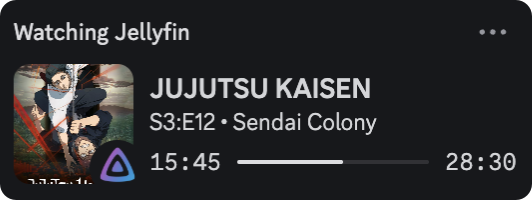
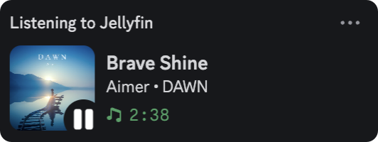
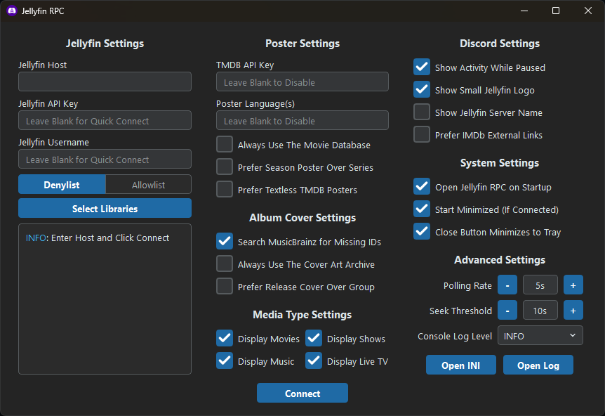

<!-- markdownlint-disable MD033 MD041 -->
<div align="center">
  
</div>
<p align="center">


</p>

Jellyfin RPC updates your Discord status with what you're watching or listening to on your Jellyfin server. Make sure your desktop client for Discord is running and your [Activity Sharing](https://support.discord.com/hc/en-us/articles/7931156448919-Activity-Sharing-on-Discord-FAQ) settings are enabled.

<p align="center">
  
  
</p>

## Installation

### Desktop GUI (Windows, macOS, Linux)

Download the executable for your platform from the [GitHub Releases](https://github.com/kennethsible/jellyfin-rpc/releases) page. A [Homebrew](https://brew.sh/) Cask is also available for macOS users. If [Gatekeeper](https://github.com/orgs/pyinstaller/discussions/8976) blocks the application on macOS, you might need to strip the quarantine attribute. Similarly, if SmartScreen blocks the application on Windows, select "More info" and then "Run anyway."

#### macOS (Homebrew)

```bash
brew install --cask kennethsible/tap/jellyfin-rpc
xattr -rd com.apple.quarantine "/Applications/Jellyfin RPC.app"
```

> [!NOTE]
> For Linux users, [AppImageLauncher](https://github.com/TheAssassin/AppImageLauncher) can automatically create a desktop shortcut and place Jellyfin RPC into your system's application launcher.

### Command-Line Interface (CLI)

Install the Python package via [pip](https://pip.pypa.io/en/stable/installation/) and then download [`jellyfin_rpc.ini`](https://github.com/kennethsible/jellyfin-rpc/blob/main/jellyfin_rpc.ini) to configure the CLI tool. Refer to the [CLI usage](#cli-usage-headless) section for more details.

```bash
pip install git+https://github.com/kennethsible/jellyfin-rpc.git
```

## Configuration

Jellyfin host can be either a public or local URL for your server. However, posters and album covers won't be retrievable from your Jellyfin server with a local URL (requires HTTPS and must be publicly accessible by Discord). In that case, Jellyfin RPC includes support for public metadata providers such as [TMDB](https://www.themoviedb.org/) and [MusicBrainz](https://musicbrainz.org/) (via the [Cover Art Archive](https://coverartarchive.org/)).

After entering your Jellyfin host, click **Connect** and use [Quick Connect](https://jellyfin.org/docs/general/server/quick-connect/) to authenticate with a user access token. To generate an API key instead, go to the server dashboard and select **API Keys** under **Advanced**.

<p align="center">
  
</p>

If running in headless/CLI mode, configuration is loaded from an INI file. If you encounter any issues, set the log level to `DEBUG` (via the GUI or INI file) and include the log output when opening a [GitHub issue](https://github.com/kennethsible/jellyfin-rpc/issues).

> [!NOTE]
> TMDB can *optionally* be used to fetch posters for movies and TV shows. However, you must create a [TMDB account](https://www.themoviedb.org/signup/) and generate an [API key](https://developer.themoviedb.org/docs/getting-started). The Cover Art Archive can be used to fetch album covers without an API key.

| Key | Default | Description |
| :--- | :--- | :--- |
| `JELLYFIN_HOST` | — | Jellyfin server URL (e.g., `https://jellyfin.example.com` or `http://localhost:8096`). |
| `JELLYFIN_API_KEY` | — | Jellyfin API key. Generated automatically when authenticating with Quick Connect. |
| `JELLYFIN_USERNAME` | — | Jellyfin username whose playback sessions are displayed in Discord. |
| `TMDB_API_KEY` | — | TMDB API key. Required for posters if your Jellyfin server is hosted locally. |
| `MEDIA_TYPES` | `Movies, Shows, Music, LiveTV` | Comma-separated list of enabled media types. Ordered from highest to lowest display priority (`Movies`, `Shows`, `Music`, `LiveTV`). |
| `SHOW_WHEN_PAUSED` | `true` | Shows paused activities with a small icon in the bottom right of the poster or album cover instead of a progress bar. Pausing clears the activity when disabled. |
| `SHOW_SERVER_NAME` | `false` | Shows your Jellyfin server name as the activity name instead of "Jellyfin". |
| `SHOW_JELLYFIN_LOGO` | `true` | Shows a small Jellyfin logo in the bottom right of the poster or album cover. |
| `IMDB_EXTERNAL_LINKS` | `false` | Prioritizes IMDb for external links over other metadata providers. |
| `POSTER_LANGUAGES` | — | Comma-separated list of languages or [two-letter codes](https://en.wikipedia.org/wiki/ISO_639-1) for TMDB posters. Uses TMDB's default image order when unset. |
| `TEXTLESS_POSTERS` | `false` | Prioritizes textless TMDB posters over language-specific posters. |
| `ALWAYS_USE_TMDB` | `false` | Uses TMDB as the primary source for posters. Serves as a fallback for missing artwork in Jellyfin when disabled. |
| `SEASON_OVER_SERIES` | `false` | Prioritizes season posters over series posters for TV shows. |
| `SEARCH_MUSICBRAINZ` | `true` | Searches MusicBrainz by artist and album title when IDs are missing in Jellyfin. |
| `ALWAYS_USE_COVERART` | `false` | Uses the Cover Art Archive as the primary source for album covers. Serves as a fallback for missing artwork in Jellyfin when disabled. |
| `RELEASE_OVER_GROUP` | `false` | Prioritizes [release](https://musicbrainz.org/doc/Release) artwork over [release group](https://musicbrainz.org/doc/Release_Group) artwork for music. |
| `LIBRARY_FILTER_TYPE` | `Denylist` | Filter behavior for selected libraries. Controls whether these libraries are allowed or blocked (`Allowlist` or `Denylist`). |
| `SELECTED_LIBRARIES` | — | Comma-separated list of Jellyfin library IDs to allow or block. Found as the `topParentId` parameter in the web client URL. |
| `POLLING_RATE` | `5` | Interval in seconds to poll Jellyfin sessions, or the minimum delay between WebSocket events (if your Jellyfin server and reverse proxy support WebSockets). |
| `SEEK_THRESHOLD` | `10` | Playback jump in seconds required to resync Discord's elapsed timer when seeking. |
| `SESSION_TIMEOUT` | `2` | Delay in seconds before clearing the activity. Smooths transitions between media items. |
| `STALE_GRACE_PERIOD` | `5` | Buffer in seconds to wait after media finishes before clearing a stale session. |
| `LOG_LEVEL` | `INFO` | Logging verbosity for the console (`DEBUG`, `VERBOSE`, `INFO`, `WARNING`, `ERROR`, `CRITICAL`). |
| `LOG_LEVEL_FILE` | `DEBUG` | Logging verbosity for the log file. Accepts the same levels as `LOG_LEVEL`. |
| `LOG_MAX_BYTES` | `5242880` | Maximum size in bytes of a log file before rotating to a new one. |
| `LOG_MAX_FILES` | `3` | Maximum number of log files to keep before deleting the oldest. |
| `DISCORD_CLIENT_ID` | — | Custom Discord application client ID. Uses the built-in application when unset. |

## CLI Usage (Headless)

```bash
jellyfin-rpc [-h] [--ini-path INI_PATH] [--log-path LOG_PATH]

options:
  --ini-path INI_PATH
  --log-path LOG_PATH
```

If not specified, configuration and log files default to the following directories:

- `%AppData%\Jellyfin RPC` (Windows)
- `~/Library/Application Support/Jellyfin RPC` (macOS)
- `~/.config/jellyfin-rpc` (Linux)

## Building from Source

> [!NOTE]
> For Linux builds, refer to the PyInstaller GitHub Actions workflow ([see here](https://github.com/kennethsible/jellyfin-rpc/blob/main/.github/workflows/pyinstaller.yaml)) and use the system Python installation, as `uv` does not currently include font support ([astral-sh/uv/issues/15668](https://github.com/astral-sh/uv/issues/15668)).

1. Install the [uv](https://docs.astral.sh/uv/getting-started/installation/) package manager.

    ```bash
    curl -LsSf https://astral.sh/uv/install.sh | sh
    ```

2. Create a Python environment.

    ```bash
    uv venv .venv --python 3.12
    ```

3. Build the standalone executable.

    ```bash
    uv run --extra gui pyinstaller main.spec
    ```
